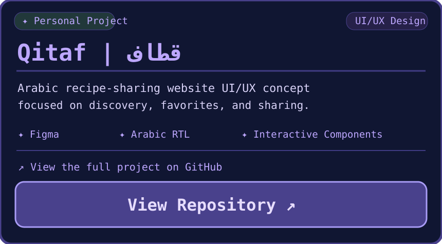

 

### Hi, I'm Hanin! 

A Software Engineering student with a passion for **UI/UX design** and building meaningful digital experiences.

I enjoy turning ideas into thoughtful interfaces and functional solutions.

 

 

 

<table width="100%">
<tr>
<td width="50%" valign="top"></td>
<td width="50%" align="right" valign="top">
<a href="https://github.com/haninverse/qitaf-recipe-website">
 

</a>
</td>
</tr>
</table>
