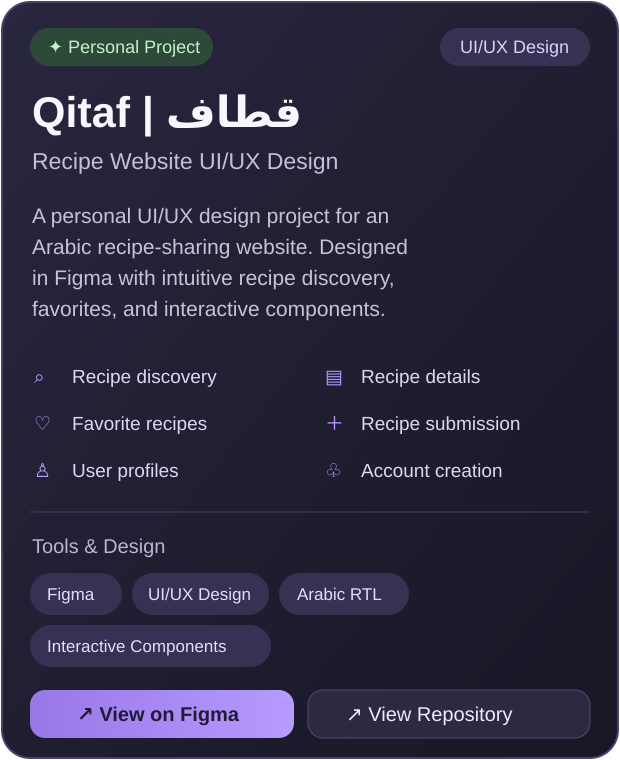

 

### Hi, I'm Hanin! 

A Software Engineering student with a passion for **UI/UX design** and building meaningful digital experiences.

I enjoy turning ideas into thoughtful interfaces and functional solutions.

 

 

<h2>✦ Featured Projects ✦</h2>

<table>
<tr>
<td width="48%" valign="middle">

</td>
<td width="52%" valign="middle">

</td>
</tr>
</table>

<a href="https://www.figma.com/design/mIpG0Sjy92SWItOHPIVM6O/Qitaf-%7C-%D9%82%D8%B7%D8%A7%D9%81-%E2%80%94-Recipe-Website-UI-UX-Design?node-id=1-296&t=7nb5f7F5qvBtylIh-1"><strong>✦ View on Figma ↗</strong></a>
&nbsp;&nbsp; · &nbsp;&nbsp;
<a href="https://github.com/haninverse/qitaf-recipe-website"><strong>↗ Project Repository</strong></a>

